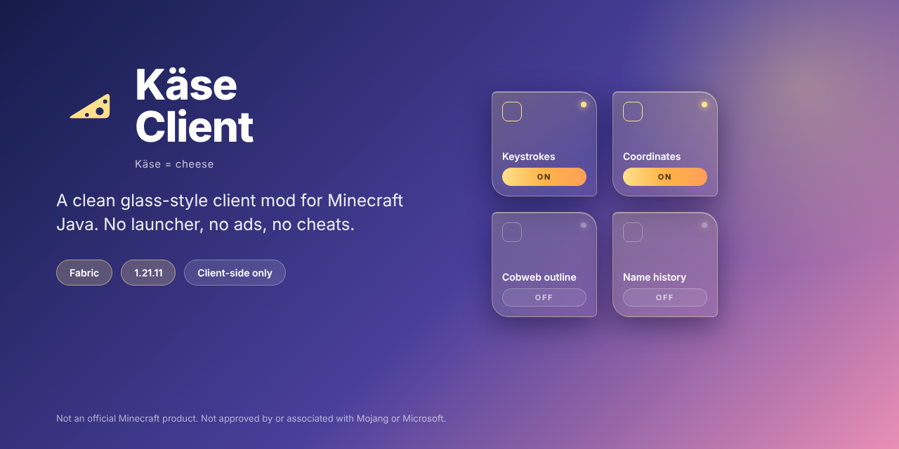

  

# 🧀 Käse Client

*Käse = cheese.*

A clean glass-style client mod for Minecraft Java Edition, built for Fabric.
No launcher, no ads, no cheats. Just a mod you drop into your `mods` folder.

> **Beta.** Käse Client is early. Expect rough edges, and please tell us about them.
> Not an official Minecraft product. Not approved by or associated with Mojang or Microsoft.

## What is it?

Käse Client is a client-side Fabric mod with glass-style menus, themes and a set of HUD and quality-of-life modules. It is purely cosmetic and informational: no combat or movement hacks.

## Why are we making it?

We are two Minecraft players who play a lot, and we kept running into the same problems with the big clients:

- **Their own launcher.** You have to switch to a different launcher just to use them. Käse Client is a normal mod, so you keep your launcher, your profiles and your other mods.
- **Ads and noise.** Menus full of promotions, shops and things you never asked for. Ours is a clean, quiet interface.
- **Features nobody needs.** Dozens of modules, most of which you switch off on day one. We build what is actually useful and make it look good.
- **A look that does not fit Minecraft.** We wanted a consistent glass style where everything can be moved, resized and recoloured.

Käse Client is also the place where we try our own ideas. We are always open to ideas and feedback, because the best features come from players.

## Features

**The usual client stuff** (every module can be switched on or off)

- FPS, ping, coordinates, CPS counter
- Keystrokes
- Armor HUD and potion HUD
- Combo counter, speedometer, day counter, IRL time
- Move and resize every module freely in the layout editor

**Our own ideas** 🤫

- Cobweb outline
- Name history

*We are not telling you how they work yet. Try them and find out.*

**Look and feel**

- Themes (Cheese by default, plus more) and your own glass color
- Minecraft mode with square corners
- Free cosmetics (see below)

## Cosmetics

There are free cosmetics. We will probably add paid ones later, but everything is free at the start, and what is free now stays free.
Cosmetics are only visible to you for now, because other players would need a server that shares them.

## Installation

1. Install [Fabric Loader](https://fabricmc.net/use/installer/) for Minecraft **1.21.11**.
2. Download [Fabric API](https://modrinth.com/mod/fabric-api) for 1.21.11 and put it into your `mods` folder.
3. Download the latest Käse Client `.jar` from the [Releases](../../releases) page and put it into the same `mods` folder.
4. Start Minecraft with the Fabric profile. Press **Right Shift** to open the layout editor.

## Supported versions

| Minecraft | Status |
|---|---|
| 1.21.11 | supported (beta) |
| 1.21 – 1.21.10 | untested, planned |

## Privacy and safety

- Käse Client is client-side only and sends no personal data anywhere.
- Some servers do not allow client mods. Check the rules of your server before you use any modules there.
- Use at your own risk, as with any mod.

## Feedback and ideas

Found a bug or have an idea? Open an [issue](../../issues) or tell us on Discord: **[YOUR DISCORD LINK]**.
When you report a bug, please include your Minecraft version, other mods you use and the `latest.log` from your `logs` folder.

## License

Käse Client is **not open source**. Copyright (c) 2026 [YOUR NAME] and [FRIEND'S NAME]. All rights reserved.

In short:
- ✅ Download it and use it for yourself, for free.
- ✅ Show it in videos, streams and screenshots (monetized is fine). Please link to this page.
- ❌ Do not re-upload, sell or modify it, and do not reuse our code, textures, sounds or logo.
- ❌ Do not use the name "Käse Client" for your own project.

The full text is in [LICENSE](LICENSE). If you want to do something that is not allowed there, ask us first.

## Credits

- Built with [Fabric](https://fabricmc.net/).
- Fonts and other third-party components: see [THIRD_PARTY.md](THIRD_PARTY.md) for sources and licenses. They keep their own licenses.

Made by **[YOUR NAME]** and **[FRIEND'S NAME]**.
